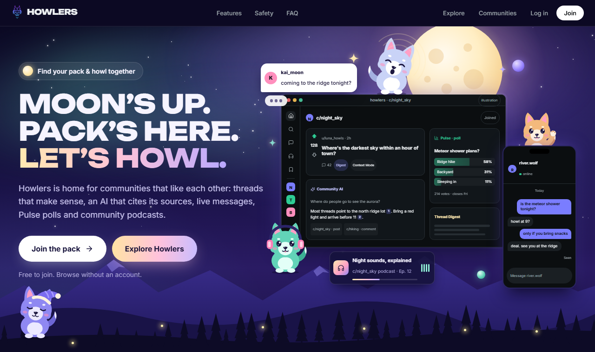
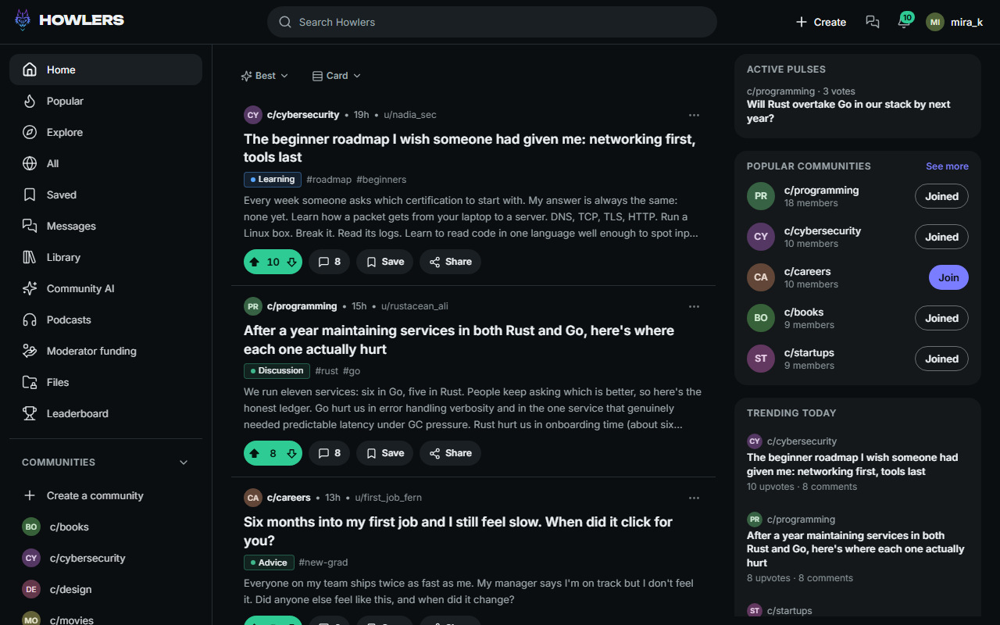
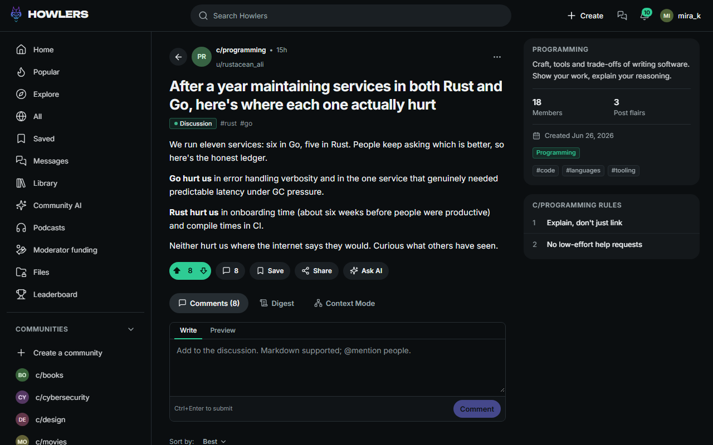

<p align="center">
  
</p>

<h1 align="center">Howlers</h1>

<p align="center"><strong>Find your pack &amp; howl together</strong></p>

<p align="center">
  A community discussion platform built to turn conversations into knowledge. Familiar if you've used
  threaded-community sites, but with original branding, ranking and product direction.
</p>

<p align="center">
  <a href="#run-it">Quick start</a> ·
  <a href="docs/PRODUCT_SPEC.md">Product spec</a> ·
  <a href="docs/ARCHITECTURE.md">Architecture</a> ·
  <a href="docs/API.md">API</a> ·
  <a href="docs/IMPLEMENTATION_STATUS.md">Status</a>
</p>



## What's inside
- **Communities, posts and threads**: text, link, image and poll posts, voting, nested comments, flairs and tags,
  with home, popular, rising and top feeds and live "new posts" updates.
- **Knowledge tools**: Thread Digest summaries, Context Mode argument maps and Smart Collections for saving and
  sharing what you learn.
- **Community AI**: answers that cite the discussions they come from. Without an AI key it runs in an honest offline
  mode that returns cited summaries instead.
- **Pulse**: community polls, predictions and debates.
- **Podcasts**: moderator-published episodes with transcripts and sources, plus a studio for drafting them.
- **Direct messages** and real-time notifications over WebSocket.
- **Files and share links**, with optional in-browser end-to-end encryption ([threat model](docs/SECURITY_E2EE.md)).
- **Moderation**: report queue, held-for-review items, bans, appeals, a moderation log, and a platform admin dashboard.
- **Moderator funding** (Stripe test mode) and a **leaderboard** computed from real activity.
- **Accessibility**: axe-checked pages in both themes, keyboard support and reduced-motion support
  ([details](docs/ACCESSIBILITY.md)).

| Home feed | Post and discussion |
|---|---|
|  |  |

The screenshots show the fictional demo data that ships with local setups.

| | |
|---|---|
| Backend | Java 21, Spring Boot 3.5, Spring Security (JWT + rotating refresh cookie), JPA + SQL read models, Flyway, PostgreSQL 17, Redis |
| Frontend | React 18, TypeScript, Vite, Tailwind, TanStack Query, Zustand, React Hook Form + Zod, TipTap, Recharts |
| Ops | Docker Compose, nginx, GitHub Actions |

## Run it

### Option A: Docker
```bash
cp .env.example .env      # set DATABASE_PASSWORD and JWT_SECRET (openssl rand -base64 48)
docker compose up --build
```
Open http://localhost:8088. API docs: http://localhost:8088/swagger-ui.html.

### Option B: Local processes (no Docker)
Prereqs: JDK 21, Node 22+, PostgreSQL 15+ and Redis (optional: rate limiting falls back to memory without it).

```bash
# database (defaults expect port 5433, db/user/password "howlers")
createdb -p 5433 -U howlers howlers

cd backend && ./mvnw spring-boot:run        # http://localhost:8080, runs migrations + demo seed
cd frontend && npm install && npm run dev   # http://localhost:5173 (proxies /api to :8080)
```
Override the DB with `DATABASE_URL`, `DATABASE_USER` and `DATABASE_PASSWORD`. Every setting is listed in
`backend/src/main/resources/application.yml` and `.env.example`.

### Demo accounts
With `SEED_DEMO_DATA=true` (the default outside the `prod` profile), fictional demo users are created, such as
`mira_k`, `nadia_sec` and `first_job_fern`, all with the password **`howlers-demo-1`**. The content is
illustrative demo data, not real activity. Disable it in production.

`admin_demo` (same password) is a platform admin: sign in and open **Admin dashboard** from the account menu (`/admin`).
It's created whenever demo seeding is on, including on databases seeded before it existed.

### Community AI
Set `ANTHROPIC_API_KEY` (server-side) and `AI_MODEL` (the model id from your AI provider) to get answers from a hosted AI model (override with
`AI_MODEL` / `AI_EFFORT`). Without it, Community AI still works in offline mode: it returns cited summaries of the
most relevant discussions and says clearly that they aren't generated answers.

Verification and password-reset emails are printed to the backend log (`MAIL-DEV`) unless `MAIL_MODE=brevo` (Brevo's
API) or `MAIL_MODE=smtp` is set; see docs/DEPLOYMENT.md, "Email with Brevo".

## Test
```bash
cd backend && ./mvnw test      # unit + integration tests on embedded PostgreSQL (no Docker needed)
cd frontend && npx vitest run && npm run build
```
End-to-end and accessibility tests: see [docs/FRONTEND.md](docs/FRONTEND.md) and [docs/ACCESSIBILITY.md](docs/ACCESSIBILITY.md).
Load test: see [docs/PERFORMANCE.md](docs/PERFORMANCE.md).

## Docs
[Product spec](docs/PRODUCT_SPEC.md) · [Architecture](docs/ARCHITECTURE.md) · [Database](docs/DATABASE.md) ·
[API](docs/API.md) · [Ranking](docs/RANKING.md) · [Design system](docs/DESIGN_SYSTEM.md) ·
[Frontend](docs/FRONTEND.md) · [Decisions](docs/DECISIONS.md) · [Roadmap](docs/ROADMAP.md) · [Deployment](docs/DEPLOYMENT.md) ·
[Accessibility](docs/ACCESSIBILITY.md) · [Performance](docs/PERFORMANCE.md) · [Brand assets](docs/brand/README.md)

## Production notes
Use `SPRING_PROFILES_ACTIVE=prod` (secure cookies, seeding off), serve over HTTPS (`COOKIE_SECURE=true`), set a
strong `JWT_SECRET`, and put Postgres backups on the `pgdata` volume. Flyway applies migrations on startup.
To troubleshoot, check `/actuator/health` first. Every error response carries a `traceId` that matches
the backend log line.
